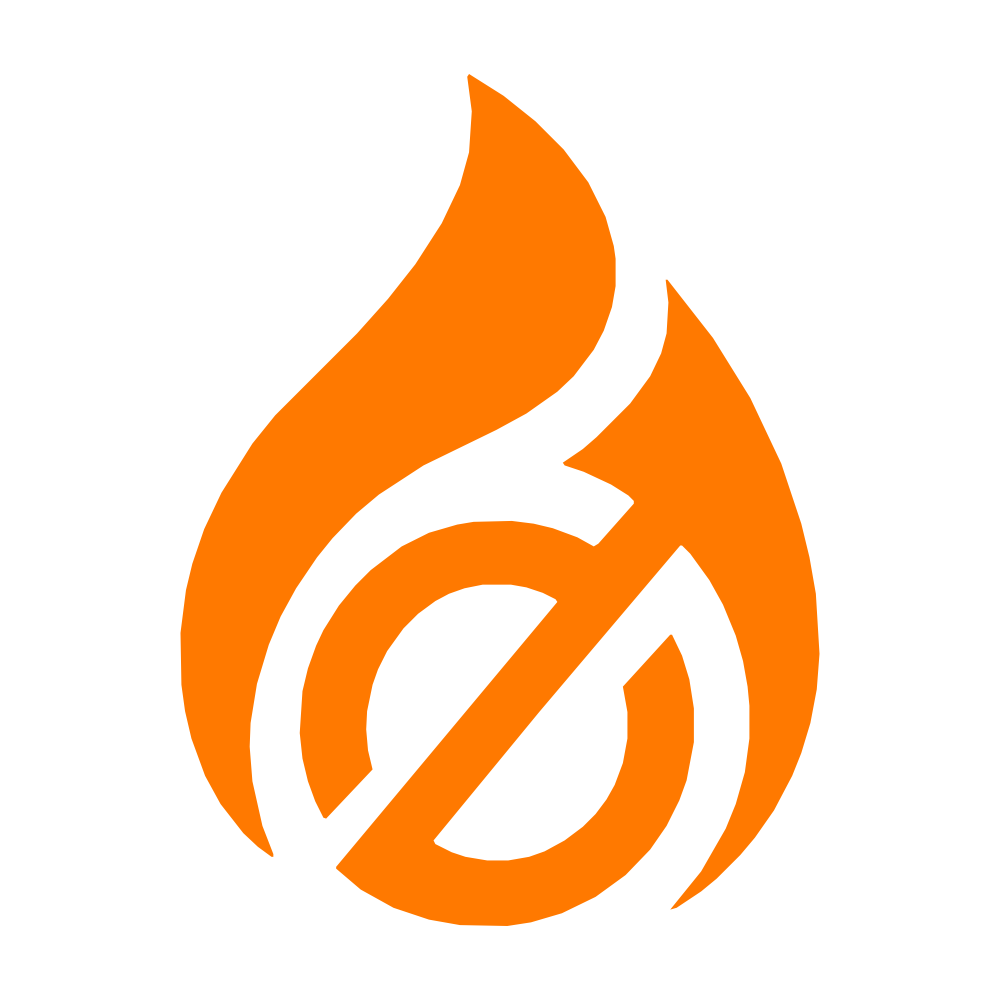
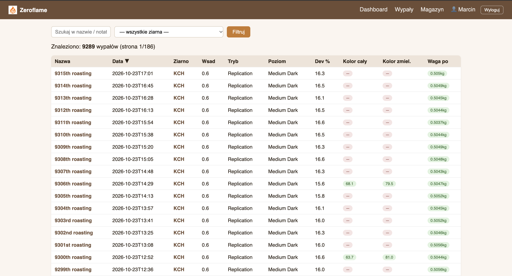

<p align="center">
  
</p>

<p align="center">
  <a href="https://github.com/poncheck/zeroflame">github.com/poncheck/zeroflame</a>
</p>

# Zeroflame ☕🔥

Self-hosted roast-log & green-bean-inventory tracker built for [Boost](https://boost.stronghold.coffee)-connected
roasters (Stronghold roasting machines). It pulls every roast from your Boost
account into a local SQLite database, lets you add manual measurements
(bean color via Agtron/colorimeter, post-roast weight) through a simple web
UI, tracks green bean inventory and usage per roast, and supports reading
live Agtron color readings straight from a **DiFluid Omni** colorimeter over
Bluetooth, directly in the browser (no extra hardware needed).

<p align="center">
  
</p>

## Features

- **Roast database** — full scrape of Boost roast history: metadata, phase
  breakdown (drying/yellowing/development), full temperature & heat-control
  curves, per-second resolution.
- **Web dashboard** (`/`, `/roasts`, `/roast/<id>`) — searchable/sortable
  roast list, detail page with temperature chart, inline quick-edit popup
  for color/weight.
- **Bean color widget** — circular gradient visualization of whole vs.
  ground bean Agtron color (shows roast depth/evenness at a glance).
- **DiFluid Omni Bluetooth integration** — connect directly from Chrome
  (Web Bluetooth API) to measure Agtron color and auto-fill the form; no
  ESP32 bridge or server-side component required.
- **Green bean inventory** — stock levels, tags, batches, moisture
  readings, auto-synced usage from roasts.
- **Login-gated** — simple username/password auth (SQLite-backed,
  werkzeug password hashing).
- **Incremental sync** — a lightweight script checks for new roasts every
  minute and keeps the inventory in sync; safe to re-run, stays quiet when
  there's nothing new.

## What's next

Short, ordered task list distilled from [ROADMAP.md](ROADMAP.md) — this is
roughly the order we're planning to tackle things in (see the roadmap for
full details on each item):

- [ ] **Production WSGI server** — swap Flask's dev server for gunicorn
      behind the reverse proxy (currently running in production with the
      dev-server warning).
- [ ] **Automated backups** on the production host (cron + rotation).
- [ ] **Edit bean/lot after roasting** — fix a wrong/missing bean
      assignment from the roast detail page, with inventory
      stock-movement correction.
- [x] **User accounts, roles & permissions** — self-service password
      change, admin user-management panel, role-based permissions
      (admin/roaster/viewer).
- [x] **Responsive design** — make every page usable on phone/tablet
      (prerequisite for the item below).
- [x] **Add to iPhone home screen** (PWA basics — manifest, apple-touch-icon,
      standalone mode).
- [ ] **Cupping module** — SCA scoring linked to `roast_id`/`bean_id`,
      multi-taster sessions, blind coding.
- [ ] **IKAWA sample roaster import** — import IKAWA test-roast CSV
      exports as sample roasts linked to a green-bean lot (feeds the
      cupping module once it exists).
- [ ] **GoStock (stock.gopos.io) integration** — sync green-bean inventory
      + push daily production into GoStock bundles.
- [ ] **Bag/batch label printing** — simple PDF labels per roasted batch,
      generated at end of day alongside the GoStock production push.
- [ ] **Multilanguage support** — PL (default) / EN / KO, per-user language
      switch.
- [ ] CSV/JSON export from the dashboard.
- [ ] Low-stock alerts.
- [ ] Cost tracking (COGS) per green-bean lot.

## Quick start (Docker)

```bash
git clone https://github.com/poncheck/zeroflame.git
cd zeroflame
cp .env.example .env
# edit .env: set BOOST_EMAIL/BOOST_PASSWORD (if you want auto-sync),
# FLASK_SECRET_KEY (generate one, see comment in .env.example),
# and ADMIN_USERNAME/ADMIN_PASSWORD for your first login.

docker compose up -d --build
```

The app will be available at **http://localhost:8088**. Log in with the
`ADMIN_USERNAME`/`ADMIN_PASSWORD` you set in `.env` (only used once, on
first container start, to create that user in `auth.db`).

Roast data is stored in a Docker named volume (`zeroflame_data`), so it
survives container restarts/rebuilds. To back it up:

```bash
docker run --rm -v zeroflame_data:/data -v "$PWD":/backup alpine \
  tar czf /backup/zeroflame-data-backup.tar.gz -C /data .
```

### Without Boost auto-sync

If you leave `BOOST_EMAIL`/`BOOST_PASSWORD` empty, the container will skip
the background sync loop and just serve whatever's already in the
database — useful if you want to import historical data manually (see
below) instead of scraping Boost live.

## Importing historical data

Two one-off scripts are included for migrating existing data into a fresh
database (run them with `docker compose exec zeroflame ...` or locally,
see "Running without Docker" below):

```bash
# Full historical scrape from Boost (first-time population; can take a while)
python3 scripts/boost_build_db.py --concurrency 15

# Parse "kolor cały 55 zmielony 80 waga 480g" style notes already stored in Boost
python3 scripts/boost_parse_notes.py --dry-run   # preview
python3 scripts/boost_parse_notes.py             # apply

# Import a historical CSV export (whole/ground Agtron + post-roast weight)
python3 scripts/boost_import_csv.py --csv /path/Wypaly.csv --db /app/data/boost_roasts.db           # dry run
python3 scripts/boost_import_csv.py --csv /path/Wypaly.csv --db /app/data/boost_roasts.db --apply    # commit
```

## Running without Docker

Requires Python 3.12+.

```bash
python3 -m venv .venv
source .venv/bin/activate
pip install -r requirements.txt
playwright install firefox   # only needed for Boost sync scripts

cp .env.example .env
# edit .env — set ZEROFLAME_DATA_DIR to a local path, e.g. ./data

python3 scripts/init_db.py                       # creates auth.db / inventory db + first admin user
python3 scripts/boost_build_db.py                # one-time full scrape (optional)
python3 webapp/boost_webapp.py --host 0.0.0.0 --port 8088
```

To keep roasts syncing automatically outside Docker, schedule
`scripts/boost_incremental_update.py` via cron (e.g. every minute during
roasting hours):

```cron
* 7-20 * * * cd /path/to/zeroflame && /path/to/.venv/bin/python3 scripts/boost_incremental_update.py >> data/sync.log 2>&1
```

## Configuration

All configuration is via environment variables / `.env` (see
`.env.example` and `common/config.py`):

| Variable | Required | Description |
|---|---|---|
| `BOOST_EMAIL` / `BOOST_PASSWORD` | only for auto-sync | Boost login credentials |
| `BOOST_PROD_CD` | no | Boost device/product code (default: `3528`) |
| `ZEROFLAME_DATA_DIR` | no | Where the 3 SQLite DBs live (default: `/app/data` in Docker) |
| `FLASK_SECRET_KEY` | **yes, for production** | Session signing key — generate a real random value |
| `ADMIN_USERNAME` / `ADMIN_PASSWORD` | only on first run | Bootstraps the first login via `scripts/init_db.py` |

## Project structure

```
common/            shared config (env loading, DB paths)
scripts/           scraper, incremental sync, inventory sync, CSV import, DB bootstrap
webapp/            Flask app + Jinja templates
docker/            container entrypoint
Dockerfile
docker-compose.yml
```

See [ROADMAP.md](ROADMAP.md) for planned features (cupping module and more).

## Managing users via CLI (inside Docker)

User accounts can be managed either through the in-app admin panel
(**Użytkownicy** in the nav, visible to `admin` role) or with
`scripts/manage_users.py`, run inside the running container with
`docker compose exec` — useful for scripting or if you're locked out of
the UI:

```bash
# Add a new admin account
docker compose exec zeroflame python3 scripts/manage_users.py create-admin <username> <password>

# Add a regular account (defaults to role 'roaster'; pass 'viewer' for read-only)
docker compose exec zeroflame python3 scripts/manage_users.py create-user <username> <password> [roaster|viewer]

# Change any user's password (e.g. if someone forgot theirs)
docker compose exec zeroflame python3 scripts/manage_users.py set-password <username> <new_password>

# Change a user's role
docker compose exec zeroflame python3 scripts/manage_users.py set-role <username> <admin|roaster|viewer>

# List all accounts
docker compose exec zeroflame python3 scripts/manage_users.py list
```

Run these from the directory containing `docker-compose.yml` on the
server. No restart needed — changes apply immediately (and the running
container doesn't need to be stopped).

### Roles & permissions

Three roles, enforced server-side (not just hidden in the UI):

- **admin** — everything `roaster` can do, plus the user-management panel
  (`/admin/users`): create/delete accounts, change roles, reset anyone's
  password.
- **roaster** — day-to-day use: edit roast color/weight, manage inventory
  (tags, status, moisture readings, bean descriptions).
- **viewer** — read-only. Can browse roasts/inventory/dashboard but all
  write endpoints return `403`; edit forms render as disabled/hidden.

Every user (any role) can change their own password from **Zmień hasło**
in the nav (`/account/password`) without admin involvement. An admin
can't demote or delete their own account (prevents accidental lockout).


## DiFluid Omni Bluetooth integration

The roast detail page can connect directly to a DiFluid Omni colorimeter
over Bluetooth Low Energy using the browser's native Web Bluetooth API
(Chrome/Edge on desktop or Android — no app, no bridge hardware). It
implements DiFluid's published open BLE protocol (service `0x00E0`,
characteristic `AA01`) to trigger a measurement and read back the Agtron
value, auto-filling the whole/ground color field on the form.

Note: the Omni's BLE protocol does not expose a "read measurement history"
command — only live readings. Each measurement must be taken through this
page (or manually entered) to be recorded.

## License

Private/internal project — no license granted for redistribution unless
you are the repository owner.
